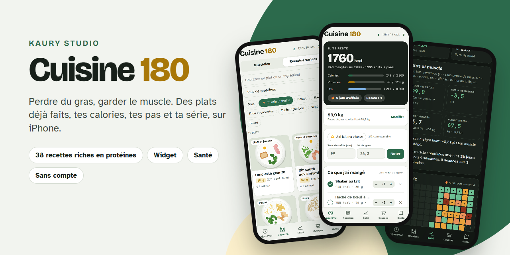
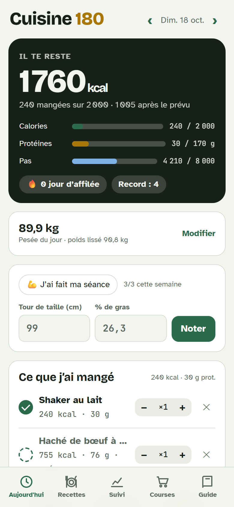
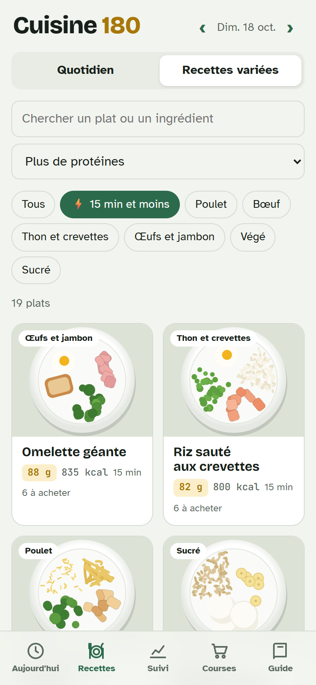
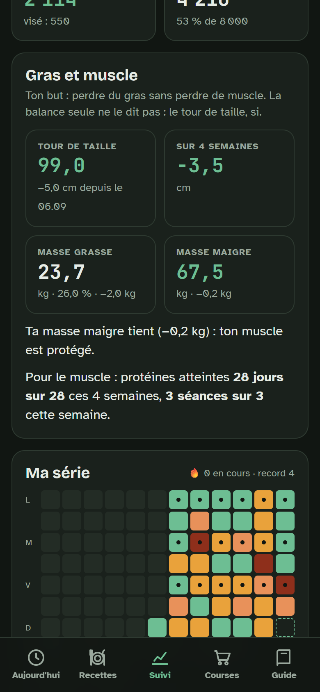
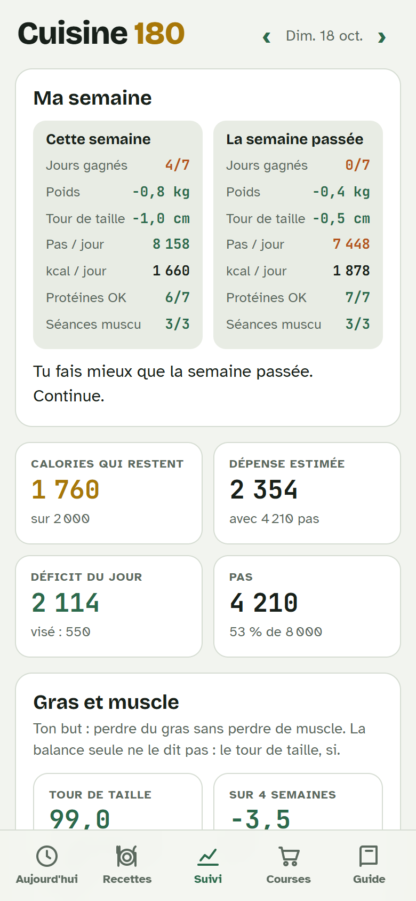
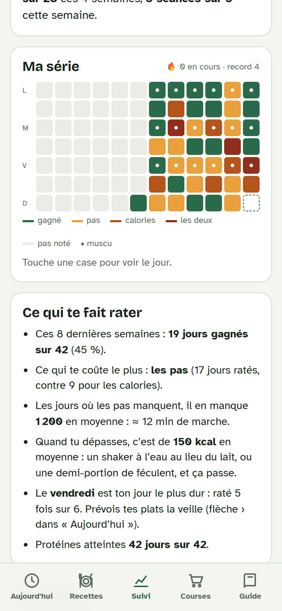
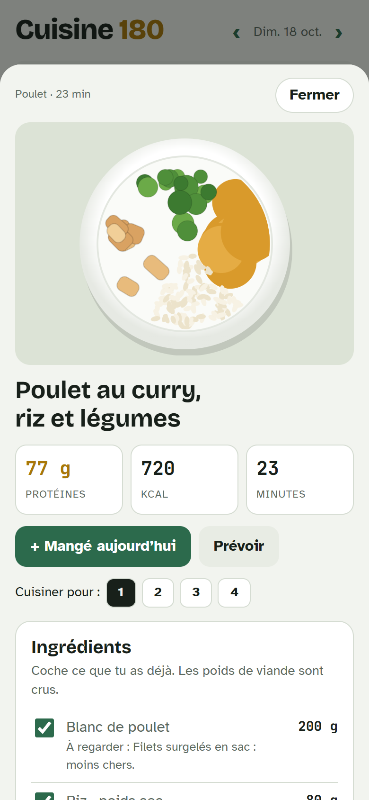

<div align="center">



<br>

[](https://github.com/theoblondel/kaury-cuisine/actions/workflows/tests.yml)
[](https://github.com/theoblondel/kaury-cuisine/releases/latest)
[](LICENSE)
[](https://apps.apple.com/app/scriptable/id1405459188)

**[Télécharger](https://github.com/theoblondel/kaury-cuisine/releases/latest)** ·
**[Installer](#installation)** ·
**[Comment c'est calculé](#comment-cest-calculé)** ·
**[In English](#in-english)**

</div>

---

**Cuisine 180** aide à **perdre du gras sans perdre de muscle**. Tu choisis tes repas parmi des plats déjà faits, riches en protéines, et l'appli compte tout : calories, protéines, pas. Elle suit aussi ton poids, ton tour de taille et ta série de jours gagnés. Le widget te montre d'un coup d'œil ce qu'il te reste pour la journée.

Un seul fichier, exécuté par [Scriptable](https://apps.apple.com/app/scriptable/id1405459188). Pas de compte, pas de serveur, pas d'abonnement. Tes données restent dans ton iCloud.

<div align="center">
  
  &nbsp;
  
  &nbsp;
  
</div>

## Fonctionnalités

### Manger

| | |
|---|---|
| **Plats déjà faits** | 38 recettes autour de 75 g de protéines et 650 à 900 kcal, dont 15 en un quart d'heure. Quantités, préparation, liste de courses. |
| **Compose ton assiette** | 3 protéines × 3 féculents × 4 légumes × 4 goûts : 144 assiettes avec 17 produits de base. |
| **Journal du jour** | Un toucher pour noter un plat, le shaker, ou « autre chose ». Portions par demi, annulation, « Comme la veille ». |
| **Prévu, puis mangé** | Prévois tes plats le matin ou la veille (pour les courses), coche-les quand c'est mangé. Seul le mangé compte. |
| **Produits du magasin** | Recherche par nom ou par code-barres sur [Open Food Facts](https://world.openfoodfacts.org), les produits vendus en Suisse d'abord. |
| **Allergènes** | Lactose et gluten : les ingrédients passent à leur version « sans ». Œufs : les plats concernés sont masqués. |
| **Pour Yazio** | Chaque plat, et la journée entière, en grammes, prêts à copier. |

### Suivre

| | |
|---|---|
| **Objectifs calculés** | Calories, protéines et pas d'après ta taille, ton âge, ton poids et le rythme choisi. Jamais sous ton métabolisme de base. |
| **La série** | Un jour est gagné sous l'objectif de calories **et** au-dessus de l'objectif de pas. La journée en cours ne casse rien avant minuit. |
| **Gras et muscle** | Tour de taille, % de gras (masse grasse et masse maigre), séances de muscu. L'appli repère la recomposition : poids stable, tour de taille en baisse. |
| **Ma semaine** | Bilan comparé à la semaine passée, et en notification le dimanche soir. |
| **Ce qui te fait rater** | Les pas ou les calories, de combien en moyenne, et ton jour le plus dur. |
| **Poids prévu et réel** | Le poids que tes déficits annoncent, face à ton poids lissé. Après 3 semaines, l'appli en déduit ta vraie dépense. |
| **Projection** | La date de ton poids visé, et ce que +1 000, +2 000 ou +3 000 pas par jour y changent. |
| **Graphiques** | Poids, pas, protéines, déficit, tour de taille sur 14, 30, 90 jours ou tout. |

### Sur l'iPhone

| | |
|---|---|
| **Widget** | Petit, moyen, grand, et trois formats pour l'écran verrouillé. Boutons « + Shaker », « + Plat », « Scanner » et « Poids ». |
| **Santé** | Un Raccourci envoie tes pas (et si tu veux ton poids, ton % de gras, ton tour de taille, tes séances) plusieurs fois par jour. |
| **Alerte du soir** | Une notification si ta série est en jeu : « Il te manque 2 300 pas ». |
| **Clair et sombre** | L'appli suit le réglage de l'iPhone. |

<div align="center">
  
  &nbsp;
  
  &nbsp;
  
</div>

## Installation

> Dix minutes, une seule fois. Il faut un iPhone sous iOS 16 ou plus récent.

1. **Installer Scriptable** depuis l'[App Store](https://apps.apple.com/app/scriptable/id1405459188) (gratuit), puis l'ouvrir une fois.
2. **Télécharger `Cuisine.180.js`** depuis la [dernière version](https://github.com/theoblondel/kaury-cuisine/releases/latest), puis sur l'iPhone : **Partager → Enregistrer dans Fichiers → iCloud Drive → Scriptable**. GitHub remplace l'espace du nom par un point : renomme-le **`Cuisine 180`** dans Scriptable si tu veux, le nom ne change rien au fonctionnement.
3. **Lancer le script** : dans Scriptable, toucher **Cuisine 180**. Il pose ses questions une fois (taille, âge, poids, poids visé, rythme, pas, allergènes) et calcule tes objectifs.
4. **Ajouter le widget** : appui long sur l'écran d'accueil → **+** → **Scriptable**, puis appui long sur le widget → **Modifier le widget** :

   | Réglage | Valeur |
   |---|---|
   | Script | `Cuisine 180` |
   | When Interacting | `Run Script` |

5. **Brancher Santé** (pas, poids, alerte du soir) et **le scanner de code-barres** : deux Raccourcis à créer, pas à pas dans **[INSTALLATION.md](INSTALLATION.md)**.

**Mettre à jour** : remplacer le script dans le dossier Scriptable (en gardant le même nom). Tes données, dans `cuisine-180.json`, ne bougent pas.

## Comment c'est calculé

- **Métabolisme de base** : formule de Mifflin-St Jeor.
- **Dépense du jour** : métabolisme × 1,2, plus ≈ 0,0005 kcal par pas et par kilo au-delà de 2 000 pas.
- **Objectif de calories** : dépense avec ton objectif de pas, moins le déficit du rythme choisi (7 700 kcal ≈ 1 kg). Jamais sous ton métabolisme de base, ni sous 1 500 kcal (homme) ou 1 200 kcal (femme).
- **Protéines** : 2 g par kilo de poids visé, ou de poids à IMC 25.
- **Poids lissé** : moyenne mobile exponentielle des pesées (chaque pesée compte pour 20 %). La tendance est sa pente sur 4 semaines.
- **Garde-fou muscle** : au-delà d'environ 1 % du poids perdu par semaine, l'appli prévient qu'une partie de la perte peut venir du muscle.
- **Masse grasse et maigre** : poids lissé × % de gras de la balance. Ces balances se trompent de plusieurs points : l'appli compare la moyenne des 3 premières et des 3 dernières mesures.
- **Recettes** : protéines et calories calculées ingrédient par ingrédient (`test/nutrition.mjs`). Les tests bloquent tout écart de plus de 6 g ou 8 %.

Ce sont des estimations, pas un avis médical. Pour un régime strict, une maladie ou une grossesse, parles-en à un médecin ou à un diététicien.

## Tes données

Tout est dans **iCloud Drive › Scriptable › `cuisine-180.json`** : un fichier lisible, que tu peux sauvegarder depuis ton ordinateur. Rien ne part ailleurs, sauf ce que tu cherches sur Open Food Facts (le nom ou le code-barres du produit).

## Développement

Le script est assemblé depuis `src/` :

```bash
node build.mjs              # écrit « Cuisine 180.js »
node test/simulateur.mjs    # 33 tests : calculs, Raccourcis, widgets, page, recettes
node test/nutrition.mjs     # protéines et kcal de chaque recette face au calcul
node test/simulateur.mjs apercu   # test/apercu.html : la page avec 6 semaines d'exemple
```

| Fichier | Rôle |
|---|---|
| `src/script.js` | Côté Scriptable : fichier iCloud, widget, WebView, Raccourcis, notifications. |
| `src/calculs.js` | Calculs purs, partagés par le widget, la page et les tests. |
| `src/recettes.js` | Ingrédients, recettes, compositeur, allergènes, assiettes dessinées. |
| `src/page.html` · `src/page.js` | L'appli, dans la WebView de Scriptable. |

Les tests tournent sans iPhone : `test/simulateur.mjs` imite les objets de Scriptable.

## In English

**Cuisine 180** is an iPhone app, run by [Scriptable](https://apps.apple.com/app/scriptable/id1405459188), for **losing fat while keeping muscle**. Log meals in one tap from 38 ready-made, high-protein recipes (or any product from Open Food Facts), and it tracks calories, protein, steps from Apple Health, weight, waist size and body fat. It shows your daily streak, a weekly report, why you miss days, and when you will reach your goal. No account, no server, no subscription: your data stays in your iCloud. The interface is in French.

Install: get Scriptable, save [`Cuisine.180.js`](https://github.com/theoblondel/kaury-cuisine/releases/latest) to *iCloud Drive › Scriptable*, run it once, then add a Scriptable widget pointing to it. Health and barcode shortcuts are described in [INSTALLATION.md](INSTALLATION.md).

## Licence

[MIT](LICENSE) · Kaury Studio. Les données produits viennent d'[Open Food Facts](https://world.openfoodfacts.org), sous licence [ODbL](https://opendatacommons.org/licenses/odbl/1-0/).
